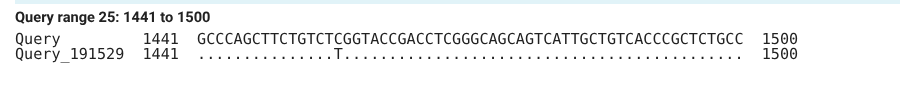
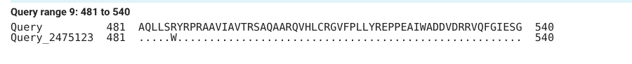
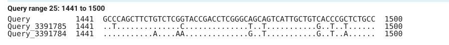
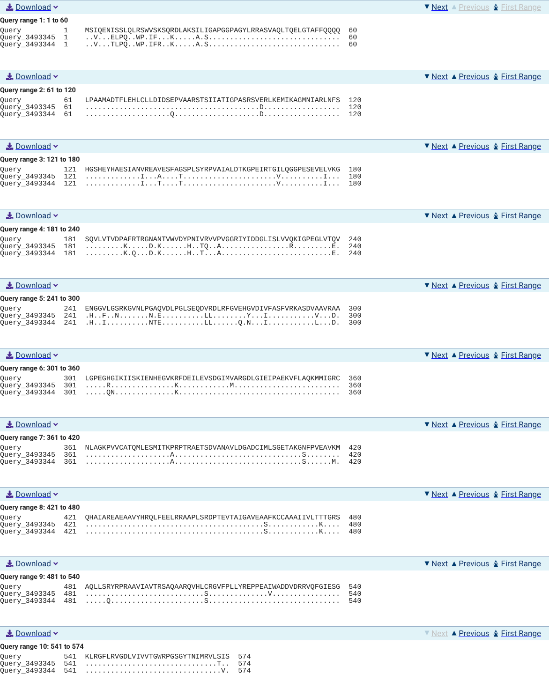
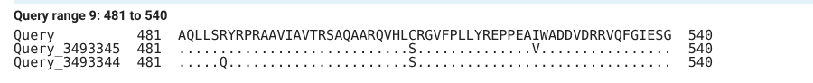

# Lab 1: Sequence alignment

Group 11DP-C · Pyruvate Kinase Deficiency

Tool: NCBI BLAST (Altschul *et al.* 1990), as in the lab handout: blastn for coding sequences (CDS), blastp for proteins, default settings. Every step (forms, results, downloads) is saved in `analysis/procedures/` (folders `2_identification`, `3_variant`, `4_homologs`, `8_lab1_three_species`).

---

## Session 1 · Sequence search

### 1.1–1.2 Which gene and protein are the supplied sequences?

| Supplied file | BLAST program and database | Best curated hit | Query cover | Identity | E-value |
|---|---|---|---|---|---|
| `PKD_CDS_WT.fasta` (1725 nt) | blastn, core_nt | **NM_000298.6**, *Homo sapiens* pyruvate kinase L/R (*PKLR*), transcript variant 1, mRNA | 100% | 100.00% (1725/1725) | 0.0 |
| `PKD_protein_WT.fasta` (574 aa) | blastp, ClusteredNR | **NP_000289.1**, pyruvate kinase PKLR isoform 1 [*Homo sapiens*] | 100% | 100.00% (574/574) | 0.0 |
| `PKD_CDS_mutant.fasta` | blastn, core_nt | NM_000298.6 | 100% | 99.94% (1 mismatch) | 0.0 |
| `PKD_protein_mutant.fasta` | blastp, ClusteredNR | NP_000289.1 | 100% | 99.83% (1 mismatch) | 0.0 |

Several predicted human records (XM_…) have the same score as NM_000298.6; following the handout, we chose the curated RefSeq entries (NM_, NP_).

**Q1: Does the identified protein correspond to the gene identified from the WT CDS search?**
Yes. The CDS matches the *PKLR* transcript NM_000298.6, and the protein matches NP_000289.1, the protein encoded by that same transcript.

**Q2: What is the gene locus? In which chromosome is it? How many exons does the gene have? In what tissues is the gene expressed? What is the protein name?**
- Gene *PKLR* (NCBI Gene ID 5313), chromosome 1, band **1q22**.
- Exons: 13 for the whole gene (NCBI Gene); the transcript NM_000298.6 has 11 exons.
- Tissues: the gene gives two forms of the enzyme. The **R-type**, encoded by our transcript (variant 1), is the red-cell form; the **L-type**, encoded by transcript variant 2 (NM_181871.4), is the liver form (UniProt P30613, isoforms R-type and L-type).
- Protein: pyruvate kinase PKLR, R-type isoform, 574 amino acids (NP_000289.1; UniProt **P30613**).

**Q3: Does the mutant CDS match the same gene as your WT CDS?**
Yes. Its best hit is the same record, NM_000298.6, with 100% cover and E-value 0.0; the identity is 99.94% instead of 100%, because of one mismatch.

**Q4: Does the mutant protein match the same protein as your WT protein?**
Yes: NP_000289.1, 100% cover, E-value 0.0, identity 99.83% (one mismatch).

### 1.3–1.4 Homologs in other species

We searched with the human wild-type protein (blastp, database RefSeq protein) and CDS (blastn, database RefSeq RNA), restricting each search to one organism. For each species we took the PKLR hit that covers the whole query, that is, the red-cell (R-type) form, like our human sequence.

| Species | Protein used | CDS used | Note |
|---|---|---|---|
| Rat (*Rattus norvegicus*), assigned | XP_006232655.1 (574 aa) = UniProt **P12928** (reviewed) | XM_006232593.6 | The only curated rat entry, NP_036756.3 (NM_012624.3), is the liver form (543 aa, 94% cover). Two full-length R-type entries exist, from two rat strains: XP_006232655.1 (reference strain, Brown Norway; 91.11% identity) and XP_087472322.1 (strain SHRSP; 91.29%). We used the reference strain. |
| Mouse (*Mus musculus*), our choice | NP_038659.2 (574 aa, curated; 91.81%); for the comparison, UniProt **P53657** (reviewed) | NM_013631.2 | NP_038659.2 and P53657 differ at residues 279 and 335, far from residue 486. |

The two rat strains differ exactly at position 486: Gln in the reference strain (and in P12928 and NP_036756.3), Arg in strain SHRSP.

---

## Session 2 · Sequence alignment

### 2.1 Wild type vs mutant CDS

BLAST "Align two or more sequences" (blastn): wild-type CDS as the first sequence, mutant CDS as the second. **Identities 1724/1725 (99%), gaps 0/1725.**

**Picture 1.** Query-anchored view with dots for identities, positions 1441–1500. Dots are identical positions; the only letter is the T at position 1456.

The mutation is a nucleotide substitution: **c.1456C>T**.

**Q5: If the mutation is a nucleotide substitution, is it synonymous, missense or nonsense?**
**Missense.** Nucleotide 1456 is the first base of codon 486 (codon *n* starts at 3*n* − 2), which changes from CGG (arginine) to TGG (tryptophan). It is not synonymous (the amino acid changes) and not nonsense (TGG is not a stop codon).

**Q6: If nucleotides have been inserted or deleted, could the change alter the reading frame (i.e. frameshift)?**
Yes, if the number of inserted or deleted nucleotides is not a multiple of three: all codons after the change would be read in a different frame. Our variant is a substitution: both CDSs have 1725 nt and the alignment has no gaps, so there is no frameshift.

### 2.2 Wild type vs mutant protein

BLAST "Align two or more sequences" (blastp). **Identities 573/574 (99%), gaps 0/574.**

**Picture 2.** Query-anchored view with dots, residues 481–540. The only letter is the W at position 486.

The protein change is **p.Arg486Trp (R486W)**.

**Q7: How do the properties of the WT and mutant amino acids differ?**
Arginine (Arg, R) is basic: its side chain is positively charged. Tryptophan (Trp, W) is hydrophobic and aromatic (a double ring, indole), with one hydrogen donor, the N–H of the ring (Škrbić *et al.* 2024). The change replaces a positive, polar side chain with a large, uncharged, hydrophobic one.

**Q8: Could the substitution change the interactions made by this position? Why?**
It could, because charge, shape, and size all change. The crystal structures show what happens (Valentini *et al.* 2002; our PyMOL measurements, `analysis/procedures/7_structure`): in the wild type (PDB 2VGB), the Arg486 side chain forms a hydrogen bond (2.7 Å) with the backbone oxygen of Leu362, at the contact between the C and A domains. In the mutant (PDB 2VGI), the N–H of the Trp486 ring forms hydrogen bonds with the backbone oxygens of Asn361 (3.0 Å) and Leu362 (3.4 Å). The contact between the two domains is kept, with different bonds.

**Q9: Could this affect how the protein folds or functions? Why?**
It could, because residue 486 sits at a contact between two domains. The measured data show which effect occurs (Valentini *et al.* 2002): the mutant protein folds normally (its structure is almost identical to the wild type, and it is slightly more stable to heat) and still responds to its activator FBP, but its catalytic efficiency drops to 30% of the wild type's. The substitution affects **function**, not folding.

**Q10: How does the sequence variant observed at the CDS level compare with the sequence variant observed at the protein level?**
One nucleotide changes in the CDS (C→T at 1456) and one amino acid changes in the protein (Arg→Trp at 486): one substitution in the DNA gives one substitution in the protein.

**Q11: How does the nucleotide variant in the CDS mutant sequence produce the observed variant in the amino-acid mutant sequence?**
Codon 486 covers nucleotides 1456–1458, and the change is in its first position. CGG codes for Arg; TGG codes for Trp (the only codon for Trp). During translation, the ribosome therefore puts Trp instead of Arg at position 486.

### 2.3 CDS of human, rat, and mouse

BLAST "Align two or more sequences" (blastn): human CDS as the first sequence; rat and mouse CDS pasted one after the other as the second. In the query-anchored view, the rat is labelled Query_3391784 (pasted first) and the mouse Query_3391785.

| Comparison | Identities | Gaps |
|---|---|---|
| Human vs rat CDS | 1494/1727 (86.5%) | 4 |
| Human vs mouse CDS | 1495/1728 (86.5%) | 6 |

**Picture 3.** Human, mouse (…785), and rat (…784) CDS, positions 1441–1500. Codon 486 is at positions 1456–1458: human CGG, mouse CGC, rat CAA.

**Q12: Are there any highly conserved regions across the three species in the CDS sequences?**
Yes. The three CDSs align from end to end (1725 nt each) with 86.5% identity, and the query-anchored view shows long runs of dots, where the three sequences are identical; the differences are scattered along the sequence.

**Q13: Are there any sequence positions with variants across the three species, either substitutions or gaps in the CDS sequences?**
- **Substitutions:** yes, 229 positions differ between human and rat and 227 between human and mouse (BLAST hit table). At codon 486, human has CGG (Arg), mouse CGC (Arg), and rat CAA (Gln) (Picture 3).
- **Gaps:** BLAST places 4 (rat) and 6 (mouse) gap positions, but the three CDSs have the same length and the proteins align without gaps (2.4), so these are pairs of one-nucleotide gaps that BLAST prefers to a mismatch, not real insertions or deletions.

### 2.4 Proteins of human, rat, and mouse

BLAST "Align two or more sequences" (blastp): human P30613; rat P12928 and mouse P53657 pasted one after the other (rat …344, mouse …345 in the query-anchored view).

| Comparison | Identities | Positives (similar) | Gaps |
|---|---|---|---|
| Human vs rat | 523/574 (91%) | 546/574 (95%) | 0 |
| Human vs mouse | 526/574 (92%) | 548/574 (95%) | 0 |

**Picture 4.** The whole protein alignment, query-anchored with dots: each letter is a residue different from human.

**Q14: Are there any highly conserved regions across the three species in the protein sequences?**
Yes. Counted in the alignment (Picture 4, with the domain limits of Valentini *et al.* 2002), 517 of the 574 positions are identical in the three species. The most conserved parts are the N domain (residues 57–84: 27 of 28 identical in all three), the C domain (432–574: 136/143), and the A domain, which contains the active site (85–159 and 263–431: 226/244).

**Q15: Are there any sequence positions with variants across the three species, either substitutions or gaps in the protein sequences?**
Yes, substitutions: 51 positions differ between human and rat and 48 between human and mouse. There are no gaps. At position 486, human and mouse have Arg, and rat has Gln (Picture 5).

**Picture 5.** Residues 481–540: the rat (…344) has Q at 486.

**Q16: Are there regions more conserved than others?**
Yes (Picture 4). The least conserved part is the beginning of the protein, residues 1–56 (43 of 56 identical in all three), which is not visible in the crystal structure. The B domain (160–262), which changes position depending on the ligands bound (Valentini *et al.* 2002), is also less conserved (85/103). The N, A, and C domains are 93–96% identical.

**Q17: Are all nucleotide sequence variants accompanied by a corresponding, equivalent amino-acid sequence variant?**
No. Human and rat differ at 229 nucleotide positions but only at 51 amino acids; many nucleotide changes do not change the amino acid, because the genetic code is redundant, especially at the third position of a codon. Example: codon 486 is CGG in human and CGC in mouse, and both code for Arg (Picture 3).

**Q18: Do the three species appear more similar at the CDS or protein level? Why?**
At the protein level (91–92% identity, 95% similarity) more than at the CDS level (86.5%). Many nucleotide changes are synonymous (Q17); changes that alter the protein are rarer because they can harm its function, and such positions tend to be conserved (Capra and Singh 2007).

**Q19: Why might some protein positions remain conserved during evolution? Using your project research, do you know whether any of these conserved regions have a known function?**
A position stays conserved when changing it would harm the protein, so variants at that position are removed by natural selection (Capra and Singh 2007). In PKLR, the residues that bind the substrate analogue in the active site (Arg116, Gly338, Asp339, Thr371) and those that bind the activator FBP (Thr475, Ser480, Arg532) (Valentini *et al.* 2002) are identical in human, rat, and mouse (Picture 4), and also in the ten vertebrates of our project.

**Q20: Is the human disease-associated variant located in a conserved region? Using your project research, what is known about the function of this region of the protein?**
Yes. Positions 476–496 are identical in the three species except 476 (Thr in human, Lys in rat and mouse) and 486 itself (Arg in human and mouse, Gln in rat) (Picture 5). Residue 486 is in the C domain, at the contact with the A domain; it is the last residue of the helix 480–486, whose other end points toward a phosphate of the activator FBP (Valentini *et al.* 2002). The contact between the A and C domains has many polar interactions, often between charged side chains, and many of these residues are sites of mutations that cause PK deficiency (Valentini *et al.* 2002).

---

## Sources

Altschul SF et al. Basic local alignment search tool. J Mol Biol 1990;215:403–10.

Capra JA, Singh M. Predicting functionally important residues from sequence conservation. Bioinformatics 2007;23:1875–82.

O'Leary NA et al. Reference sequence (RefSeq) database at NCBI: current status, taxonomic expansion, and functional annotation. Nucleic Acids Res 2016;44:D733–45.

Sayers EW et al. Database resources of the National Center for Biotechnology Information in 2025. Nucleic Acids Res 2025;53:D20–9.

Škrbić T et al. Amino-acid characteristics in protein native state structures. Biomolecules 2024;14:805.

UniProt Consortium. UniProt: the Universal Protein Knowledgebase in 2025. Nucleic Acids Res 2025;53:D609–17.

Valentini G et al. Structure and function of human erythrocyte pyruvate kinase. Molecular basis of nonspherocytic hemolytic anemia. J Biol Chem 2002;277:23807–14.
