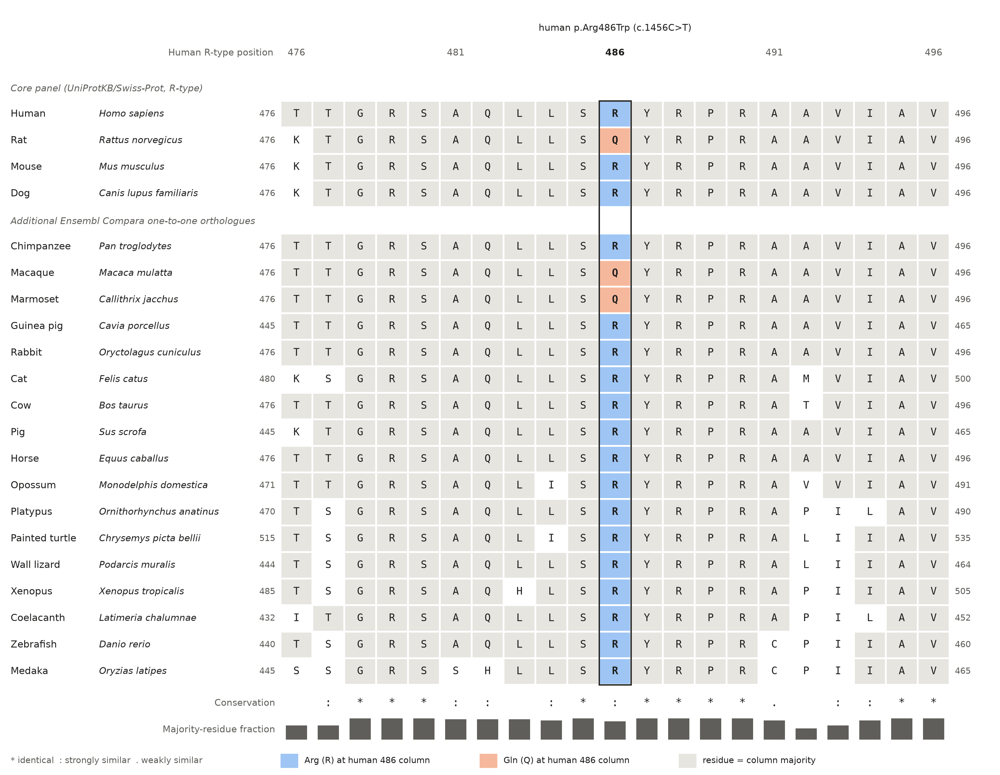
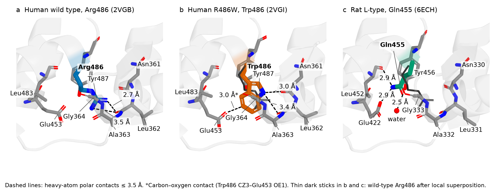

# Pyruvate Kinase Deficiency: from a *PKLR* variant to haemolytic anaemia

Aarón Godino Martínez, Bruno Carrasquilla, Ettore Colombo, Leo Nader Al Hourani, Pol Monllau

Group 11DP-C, BSc in Bioinformatics (UPC-UB-UAB-UPF), Barcelona, Spain

## Abstract

## Keywords

## Background

Pyruvate kinase (PK) catalyses the last, irreversible step of glycolysis, from phosphoenolpyruvate (PEP) and adenosine diphosphate (ADP) to pyruvate and adenosine triphosphate (ATP) (Bianchi and Fermo 2020). *PKLR* (1q22; NCBI 2026b), a paralogue of *PKM*, encodes the R- and L-type isozymes from two tissue-specific promoters whose mRNAs differ in their first exon (Bianchi and Fermo 2020), as in rat (Noguchi *et al.* 1987); the first 33 of the 574 R-type residues are replaced by two in the 543-residue L-type, whose numbering is therefore 31 lower (UniProt Consortium 2026). R-type PK is a homotetramer activated allosterically by fructose 1,6-bisphosphate (FBP); each subunit has N, A, B, and C domains, and FBP binds in the C domain (Valentini *et al.* 2002).

Red cells lack mitochondria and depend on glycolysis for ATP (Fattizzo *et al.* 2022, Luke *et al.* 2023); in pyruvate kinase deficiency (PKD), the most common glycolytic enzyme defect associated with congenital non-spherocytic haemolytic anaemia, insufficient red-cell PK activity lowers ATP and leads to premature removal of red cells, mainly in the spleen (Bianchi and Fermo 2020, Fattizzo *et al.* 2022). Inheritance is autosomal recessive; 142 of 177 unrelated patients of the PKD Natural History Study were compound heterozygous (Bianchi *et al.* 2020). Diagnosed PKD has a prevalence of 3.2–8.5 per million in Western populations (Secrest *et al.* 2020); among 254 patients, 48% had iron overload and 45% gallstones (Grace *et al.* 2018). Besides transfusion, splenectomy, and iron chelation (Grace and Barcellini 2020), the PK activator mitapivat, approved for adults (Luke *et al.* 2023), produced a haemoglobin response in 16 of 40 patients and in none of 40 on placebo in a phase 3 trial (Al-Samkari *et al.* 2022).

*PKLR* c.1456C>T, p.(Arg486Trp) (R486W), described in 1993 (Baronciani and Beutler 1993), was the most frequent *PKLR* variant in Italian and Spanish series (Zanella *et al.* 1997, Zarza *et al.* 1998). Its crystal structure is essentially unchanged although its catalytic efficiency is reduced (Valentini *et al.* 2002), and the conservation of position 486 across species had not been reported in the sources we read. To answer the course question of how sequence and structure changes explain disease and what comparison shows about function (IB Teaching Staff 2026), we aimed to (i) identify the cause of the disease at gene, protein, structure, and function level; (ii) describe how the mutant differs from the wild type; (iii) explain the consequences for the patient; and (iv) compare human PKLR with its rat, mouse, and dog orthologues, focusing on position 486.

## Results

### The supplied sequences differ by c.1456C>T, p.(Arg486Trp)

The supplied coding sequences (CDSs) are 1725 nucleotides long, have no internal stop codon, and translate into the supplied 574-residue proteins. The wild-type CDS is identical to that of NM_000298.6 (Matched Annotation from NCBI and EMBL-EBI [MANE] Select), and the wild-type protein to NP_000289.1 and UniProt P30613-1. The mutant differs only at c.1456C>T, the first position of codon 486 (CGG→TGG), a CpG site, giving p.(Arg486Trp). c.1456 lies in exon 10 of NM_000298.6 (exon 11 in the 12-exon gene numbering; Bianchi *et al.* 2020); on the L-type transcript (NM_181871.4) the change is c.1363C>T, p.(Arg455Trp).

**Table 1.** Evidence for *PKLR* c.1456C>T and for the other substitution recorded at codon 486 (gnomAD 2026, NCBI 2026a, OMIM 2026, UniProt Consortium 2026); identifiers, coordinates, and in silico scores are in `analysis/evidence/table1_variant_evidence.md`. gnomAD, Genome Aggregation Database; AC, allele count; AN, allele number; AF, allele frequency; k_cat, turnover number; S₀.₅, substrate concentration giving half-maximal rate; WT, wild type.

| Field | c.1456C>T, p.(Arg486Trp) | c.1457G>A, p.(Arg486Gln) |
|---|---|---|
| ClinVar (criteria provided, multiple submitters, no conflicts) | VCV000001513.102: Pathogenic/Likely pathogenic; 33 submitters | VCV000873616.7: Uncertain significance; two submitters |
| gnomAD v4.1, exomes + genomes | AC 4766 / AN 1 613 440; AF 0.295%; eight homozygotes | AC 47 / AN 1 613 264; AF 0.0029%; no homozygotes |
| Highest AF by group | Finnish 0.78% (v4.1); southern European 0.52% (v2.1.1 exomes, 60/11 494) | South Asian 0.012% (v4.1) |
| Share of PKD alleles | 31 of 354 unrelated alleles (9%), second most frequent (Bianchi *et al.* 2020); seven of 30 in Italy (Zanella *et al.* 1997); seven of 22 in Spain (Zarza *et al.* 1998) | not reported in the sources read |
| Recombinant enzyme, R486W vs WT (Valentini *et al.* 2002) | k_cat 195 vs 355 s⁻¹ (ratio 0.55); S₀.₅(PEP) 1.69 vs 1.10 mM; k_cat/S₀.₅(PEP) 116 vs 323 s⁻¹ mM⁻¹ (0.36) without and 492 vs 1972 (0.25) with 1 mM FBP; k_cat/S₀.₅(ADP) ratio 0.44; thermostability at 53 °C not reduced | no data |

### Position 486 is Arg in most orthologues and Gln in rat

The only reviewed UniProt PKLR entries (Table 2) are 574-residue R-type sequences and Ensembl Compara one-to-one orthologues, each more identical to human PKLR than to human PKM (rat 91.1% vs 64.5%, mouse 91.6% vs 64.1%, dog 92.5% vs 65.3%). They align without gaps; rat differs from human at 51 residues and at 152 further, synonymous codons (mouse 48 and 155; dog 43 and 121).

In the window 476–496, 19 of 21 columns are identical in the four species; the variable columns are 476 (Thr/Lys) and 486 (Arg; Gln in rat) (Figure 1). In 21 vertebrate sequences, column 486 holds Arg in 18 and Gln in three (rat, macaque, and marmoset), and Ser485 and Tyr487–Arg490 are invariant. Among the 179 jawed-vertebrate sequences of all 190 Ensembl Compara homologues, position 486 is Arg in 156, Gln in 13 (rat, six Old World and four New World monkeys, hedgehog, and sperm whale), Tyr in one (a misaligned gene model), and unresolved in nine; Trp occurs in none of the 190. By maximum parsimony, Arg is ancestral, and Gln arose repeatedly, including on the rat lineage and twice in primates.

**Figure 1.** Conservation of human PKLR position 486. Clustal Omega alignment (476–496) of the Swiss-Prot R-type sequences (top) and 17 Ensembl 116 orthologues (bottom), each in its own numbering. Framed column, human Arg486; colours and Clustal symbols as in the key; bars, fraction of sequences with the majority residue.

**Table 2.** Human PKLR (R-type) compared with its orthologues. Protein: global (Needleman–Wunsch) identity and similarity as fractions of alignment columns. CDS: position-by-position identity of the gap-free 1725-nucleotide CDSs. Mouse NP_038659.2 differs from P53657 at residues 279 and 335.

| Species | Protein (UniProtKB / RefSeq) | CDS (RefSeq) | Protein identity; similarity | CDS identity | Residue at human 486 (codon) |
|---|---|---|---|---|---|
| Human | P30613 / NP_000289.1 | NM_000298.6 | — | — | Arg486 (CGG) |
| Rat | P12928 / XP_006232655.1 | XM_006232593.5 | 523/574 (91.1%); 95.1% | 1491/1725 (86.4%) | Gln486 (CAA) |
| Mouse | P53657 / NP_038659.2 | NM_013631.2 | 526/574 (91.6%); 95.5% | 1490/1725 (86.4%) | Arg486 (CGC) |
| Dog | Q29536 / NP_001243191.1 | NM_001256262.2 | 531/574 (92.5%); 95.6% | 1544/1725 (89.5%) | Arg486 (CGG) |
| 17 vertebrates (Figure 1) | Ensembl 116 orthologues | — | 62.6–99.7% identity | — | Arg in 15; Gln in macaque, marmoset |

### Trp486 causes no change beyond model-to-model differences

Protein Data Bank (PDB) entries 2VGB (wild type; 2.73 Å; R-free 0.271) and 2VGI (R486W; 2.87 Å; R-free 0.311) are X-ray structures of tetramers with FBP, the PEP analogue phosphoglycolate, K⁺, and Mn²⁺ bound to each subunit, modelled from residue 57 to 573 (with gaps only in the B domain) in R-type numbering (RCSB PDB 2026); of 81 PDB entries for human and rat PKLR, only 2VGI carries a substitution at residue 486. Per-chain values are in `analysis/structure/TABLE_structural_measurements.md`.

**Figure 2.** Residue 486 in human R-type PK (PDB 2VGB). (a) Tetramer; domains N (orange), A (blue), B (reddish purple), and C (green) after Valentini *et al.* (2002); black spheres, residue 486. (b) Subunit A with FBP, phosphoglycolate (PGA), Mn²⁺ (purple), and K⁺ (grey); dotted lines, minimum distances from Arg486 to FBP (12.4 Å) and PGA (24.4 Å).

Arg486 lies at the C-terminal end of the C-domain helix 479–487 (Figure 2) and is largely buried (relative solvent accessibility 0.11–0.12). Its only polar partner within 3.5 Å is the main-chain carbonyl oxygen of A-domain Leu362 (NH2–O 2.74–2.90 Å); its other contacts within 4 Å are A-domain residues 361–364 and C-domain residues, it forms no salt bridge, and atoms of other subunits are at least 6.1 Å away. Its minimum distances are 12.4–12.8 Å to FBP, 24.3–24.6 Å to phosphoglycolate, and 19.5–19.6 Å to the transition-state stabilizer Lys313 (UniProt Consortium 2026). The worldwide PDB validation report flags the Arg486 side chain as a rotamer outlier in all four chains, but the Arg486–Leu362 hydrogen bond is present in seven of eight chains of an independent 2.35 Å structure (8TBS; Liu *et al.* 2024).

After superposition of 2VGI on 2VGB, the Cα root-mean-square deviation (RMSD) is 0.40–0.59 Å per subunit (N, A, and C domains 0.21–0.24 Å; B domain 0.42–0.66 Å). Around residue 486 (58–60 residues within 10 Å), the local Cα RMSD of 0.30–0.36 Å lies at the 74th–95th percentile of the same measure centred on every N-, A-, and C-domain residue (median 0.24–0.25 Å). The largest local shift is that of Glu453 OE2 towards Trp486 (1.56–1.75 Å). The Trp486 indole nitrogen lies 2.68–3.40 Å from the Asn361 and 2.82–3.37 Å from the Leu362 carbonyl oxygens, and ring atom CZ3 2.99–3.18 Å from Glu453 OE1 (Figure 3); Trp486 makes no contact with another subunit (at least 5.2 Å).

In rat L-type PK (PDB 6ECH, 2.19 Å, phosphorylated at Ser12, with FBP, Mg²⁺, ATP, and oxalate; Gassaway *et al.* 2019), Gln455 (human 486) ends the equivalent helix (local Cα RMSD to human 0.42 Å), 11.9–12.0 Å from FBP; its amide nitrogen lies 2.86–3.10 Å from Glu422 OE2 (human Glu453) and 2.88–3.25 Å from the Leu452 carbonyl, its amide oxygen 2.30–2.54 Å from a water molecule (orientation inferred), and the Leu331 carbonyl (human Leu362) 5.5–6.4 Å away (Figure 3c), as in both chains of 6ECK.

**Figure 3.** Environment of residue 486. (a) Wild-type Arg486 (PDB 2VGB, subunit A). (b) Trp486 (2VGI, subunit A) after local superposition on the wild type. (c) Rat Gln455 (6ECH, subunit D) superposed on human wild type. Dashed lines, polar contacts ≤ 3.5 Å (in Å); asterisk, Trp486 CZ3–Glu453 OE1 contact; thin dark sticks, wild-type Arg486.

### Clinical, population, and functional evidence

The gnomAD v4.1 joint allele frequency of R486W, 0.295% (exomes 0.297%, genomes 0.276%; flagged 'discrepant_frequencies'), predicts under Hardy–Weinberg equilibrium 7.0 homozygotes among the 806 720 individuals represented (eight observed), a carrier frequency of one in 170, and a homozygote frequency of 8.7 per million. Patients homozygous for R486W generally have a mild anaemia (Valentini *et al.* 2002). Four patients compound heterozygous for R486W and another missense variant (two splenectomized) had haemoglobin of 9.4–11.9 g/dL and a red-cell PK/hexokinase activity ratio of 1.6–2.7 (healthy controls, mean 11.9; n = 15); in all 15 patients of that study as a group, whole-blood PEP was increased and pyruvate and ATP decreased (Rab *et al.* 2021). In the recombinant R486W enzyme, FBP still lowered the S₀.₅ for PEP from 1.69 to 0.40 mM and the Hill coefficient from 2.07 to 1.32 (Valentini *et al.* 2002).

## Discussion

### From the variant to the patient

A CpG transition thus replaces a buried arginine at the A/C domain contact by a tryptophan that keeps a hydrogen bond to the A-domain carbonyls. As the recombinant enzyme retains FBP activation and thermostability, its defect is kinetic, unlike the instability caused by R504L and G364D at the same interface, and may be amplified by subsaturating substrate in red cells (Valentini *et al.* 2002). In compound heterozygotes, the low PK/hexokinase ratio and the metabolite pattern of their cohort indicate a block at the PK step, although both alleles contribute (Rab *et al.* 2021). Reviews describe the next steps, not measured for R486W: rigid, ATP-depleted red cells are removed in the spleen, and accumulated 2,3-diphosphoglycerate favours oxygen release (Fattizzo *et al.* 2022, Luke *et al.* 2023). The mild anaemia of homozygotes and the haemoglobin values of compound heterozygotes suggest, from few patients, a partial-loss-of-function allele whose clinical severity is set largely by the second allele. Patients with R486W meet the genotype criterion of the mitapivat trials, at least one missense variant other than R479H (Luke *et al.* 2023); their response has not been reported separately.

### Comparison with Valentini *et al.* (2002)

We confirm the A/C location, hydrogen bonds, and distance from the catalytic centre (about 20 Å or more) of Arg486 and the unchanged active site. The paper, however, names the partner 'Asp361', whereas residue 361 is Asn in P30613, the supplied sequence, and both models; reports no atomic movement above 0.25 Å, whereas the current entries (which replaced 1LIU and 1LIX in 2007) show local Cα RMSDs of 0.30–0.36 Å, within the differences found throughout the two models; and gives a catalytic efficiency of 30% of wild type, whereas its Table II values give ratios of 0.36 without and 0.25 with FBP. Its hypothesis that the tryptophan restricts conformational changes in catalysis cannot be tested with ligand-bound structures.

### What the species comparison shows about the affected function

The ancestral Arg486, present in 156 of 170 resolved orthologues and flanked by invariant residues, indicates constraint on this part of the C domain, but not absolute constraint: Gln replaced Arg independently in rat and in at least two primate lineages, and rat Gln455 satisfies its amide within the C domain, without the A/C hydrogen bond, in a folded tetramer that binds FBP and active-site ligands. This does not show that Gln or Trp is tolerated in human R-type PK, because no kinetics of Gln-carrying enzymes were found, the rat structure is of a phosphorylated L-type isoform, other sequence differences may compensate (Valentini *et al.* 2002), and human p.(Arg486Gln) is of uncertain significance. The absence of Trp from all orthologues is consistent with, but does not prove, a deleterious effect; mouse, with Arg486 and a PKD model (Morimoto *et al.* 1995), is a closer model than rat.

### Population frequency and penetrance

The predicted frequency of R486W homozygotes (8.7 per million) equals or exceeds the prevalence of diagnosed PKD of all genotypes (Secrest *et al.* 2020), and gnomAD contains as many homozygotes as random mating predicts. By the reasoning of Whiffin *et al.* (2017), many R486W homozygotes are probably not diagnosed, consistent with their mild phenotype, although gnomAD does not report phenotypes; this does not argue against pathogenicity in compound heterozygotes, as all 33 ClinVar submitters agree.

### Limitations

The truncated, ligand-bound crystal structures cannot show stability in red cells, dynamics, or inactive conformations, and their four chains, refined with non-crystallographic symmetry restraints, are not independent observations. The rat R-type CDS and primate sequences are gene models, and fish, amphibian, and reptile sequences are no more, or only marginally more, identical to human PKLR (62.6–73.0%) than to PKM, so their orthology rests on Compara gene trees. R486W-specific patient data come from small cohorts and four compound heterozygotes, with no series of homozygotes.

## Conclusions

In the recombinant enzyme, R486W changes kinetics rather than stability, crystal structure, or allosteric regulation: the catalytic efficiency with PEP falls to 25–36% of wild type while the active site and the FBP site are unchanged, by a mechanism that static structures do not resolve. Arg486 is ancestral and highly but not absolutely conserved: Gln arose repeatedly and in rat does not form the A/C hydrogen bond, and Trp occurs in none of 190 homologues. Patient and population data are consistent with a partial-loss-of-function allele whose clinical expression depends on the second *PKLR* allele.

## Methods

### Data sources and species

Records (versions in the tables and reference list) were accessed on 22 October 2026 from the HUGO Gene Nomenclature Committee (HGNC:9020), National Center for Biotechnology Information (NCBI) Gene (NCBI 2026b), RefSeq (O'Leary *et al.* 2016) with MANE Select status, Ensembl 116 and Compara (Dyer *et al.* 2025), UniProtKB/Swiss-Prot (UniProt Consortium 2026), the PDB (RCSB PDB 2026), ClinVar (NCBI 2026a), gnomAD v4.1 and v2.1.1 (gnomAD 2026), and Online Mendelian Inheritance in Man (OMIM 2026). As the rat RefSeq Select protein (NP_036756.3) is the L-type, the rat R-type CDS was taken from XM_006232593.5, whose translation equals UniProt P12928. Rat is required by our assignment, mouse is its closest relative, and dog, the fourth reviewed entry, is the outgroup (divergence about 89 million years ago, against 84 between primates and rodents; TimeTree 5, Kumar *et al.* 2022).

### Analysis

Sequences were compared with Biopython 1.88 and named after the Human Genome Variation Society recommendations (2016 update). Pairwise global alignments used the EMBOSS Needle defaults (BLOSUM62, gap opening 10, extension 0.5) and were reproduced with EMBOSS needle 6.6.0 and BLAST+ 2.17.0; multiple alignments used Clustal Omega 1.2.4, run locally with default parameters, and ancestral states were inferred by inspection under maximum parsimony. Contacts (heavy atoms ≤ 4.0 Å; polar N/O ≤ 3.5 Å) were computed with Biopython, relative solvent accessibility with FreeSASA 2.2.1, and secondary structure with DSSP in UCSF ChimeraX 1.10.1 and with PyMOL 3.1.8 (Schrödinger), which rendered Figures 2 and 3. Cα atoms were superposed by least squares without outlier rejection, and rat residues were mapped as L-type number + 31. Expected homozygotes were computed as (AN/2) × AF² and carriers as 2pq. Parameters, scripts, and step-by-step protocols are in the README files of the `analysis/` folders.

## Abbreviations

AC: allele count; ADP: adenosine diphosphate; AF: allele frequency; AN: allele number; ATP: adenosine triphosphate; CDS: coding sequence; FBP: fructose 1,6-bisphosphate; gnomAD: Genome Aggregation Database; MANE: Matched Annotation from NCBI and EMBL-EBI; NCBI: National Center for Biotechnology Information; PDB: Protein Data Bank; PEP: phosphoenolpyruvate; PGA: phosphoglycolate; PK: pyruvate kinase; PKD: pyruvate kinase deficiency; RMSD: root-mean-square deviation; WT: wild type.

## Declarations

### Availability of data and materials

Sequences, scripts, raw database responses, measurements, and protocols are in `analysis/`, figures in `figures/`, and sources in `references/` of https://github.com/XxNaderTheKing08Xx/11DP-C_Pyruvate-Kinase-Deficiency_IB_2026.

### Authors' contributions

Aarón Godino Martínez (Product Owner): literature review, patient impact, Abstract, Background, and report assembly. Bruno Carrasquilla (Sequence Analyst): sequence and conservation analyses and their Results, Figure 1, Table 2, and read-through. Ettore Colombo (Project Manager): planning, independent sequence verification, Discussion, Conclusions, and Declarations. Leo Nader Al Hourani (Data and GitHub Manager): database evidence, Table 1, alignment verification, repository and references, clinical Results, Methods, and Abbreviations. Pol Monllau (Structure Analyst): structural analyses and their Results, and Figures 2 and 3.

### Use of generative AI

As explicitly allowed by the course policy, the authors used a generative AI assistant (Claude, Anthropic) to draft and revise text, write analysis scripts, and check references and formatting. The authors guided the whole process and repeated the analyses with the tools described in Methods, verified every statement and reference against its source, and take full responsibility for the content.

## References

Al-Samkari H et al. Mitapivat versus placebo for pyruvate kinase deficiency. N Engl J Med 2022;386:1432–42.

Baronciani L, Beutler E. Analysis of pyruvate kinase-deficiency mutations that produce nonspherocytic hemolytic anemia. Proc Natl Acad Sci U S A 1993;90:4324–7.

Bianchi P, Fermo E. Molecular heterogeneity of pyruvate kinase deficiency. Haematologica 2020;105:2218–28.

Bianchi P et al. Genotype-phenotype correlation and molecular heterogeneity in pyruvate kinase deficiency. Am J Hematol 2020;95:472–82.

Dyer SC et al. Ensembl 2025. Nucleic Acids Res 2025;53:D948–57.

Fattizzo B et al. Pyruvate kinase deficiency: current challenges and future prospects. J Blood Med 2022;13:461–71.

Gassaway BM et al. Distinct hepatic PKA and CDK signaling pathways control activity-independent pyruvate kinase phosphorylation and hepatic glucose production. Cell Rep 2019;29:3394–404.e9.

gnomAD. Variants 1-155291918-G-A and 1-155291917-C-T (gnomAD v4.1.0); variant 1-155261709-G-A (gnomAD v2.1.1). 2026. https://gnomad.broadinstitute.org/ (22 October 2026, date last accessed).

Grace RF, Barcellini W. Management of pyruvate kinase deficiency in children and adults. Blood 2020;136:1241–9.

Grace RF et al. Clinical spectrum of pyruvate kinase deficiency: data from the Pyruvate Kinase Deficiency Natural History Study. Blood 2018;131:2183–92.

IB Teaching Staff. Disease Project Overview [course document]. Introduction to Bioinformatics, 2026–2027. Barcelona, 2026.

Kumar S et al. TimeTree 5: an expanded resource for species divergence times. Mol Biol Evol 2022;39:msac174.

Liu T et al. Structure-based design of AG-946, a pyruvate kinase activator. ChemMedChem 2024;19:e202300559.

Luke N et al. Updates and advances in pyruvate kinase deficiency. Trends Mol Med 2023;29:406–18.

Morimoto M et al. Pyruvate kinase deficiency of mice associated with nonspherocytic hemolytic anemia and cure of the anemia by marrow transplantation without host irradiation. Blood 1995;86:4323–30.

NCBI. ClinVar VCV000001513.102: NM_000298.6(PKLR):c.1456C>T (p.Arg486Trp); VCV000873616.7: NM_000298.6(PKLR):c.1457G>A (p.Arg486Gln). 2026a. https://www.ncbi.nlm.nih.gov/clinvar/variation/1513/ and https://www.ncbi.nlm.nih.gov/clinvar/variation/873616/ (22 October 2026, date last accessed).

NCBI. Gene ID: 5313, PKLR pyruvate kinase L/R [Homo sapiens (human)]. 2026b. https://www.ncbi.nlm.nih.gov/gene/5313 (22 October 2026, date last accessed).

Noguchi T et al. The L- and R-type isozymes of rat pyruvate kinase are produced from a single gene by use of different promoters. J Biol Chem 1987;262:14366–71.

O'Leary NA et al. Reference sequence (RefSeq) database at NCBI: current status, taxonomic expansion, and functional annotation. Nucleic Acids Res 2016;44:D733–45.

OMIM. #266200 Anemia, congenital, nonspherocytic hemolytic, 2; CNSHA2; \*609712 Pyruvate kinase, liver and red blood cell; PKLR. 2026. https://www.omim.org/entry/266200 and https://www.omim.org/entry/609712 (22 October 2026, date last accessed).

Rab MAE et al. AG-348 (mitapivat), an allosteric activator of red blood cell pyruvate kinase, increases enzymatic activity, protein stability, and ATP levels over a broad range of PKLR genotypes. Haematologica 2021;106:238–49.

RCSB PDB. 2VGB: Human erythrocyte pyruvate kinase; 2VGI: Human erythrocyte pyruvate kinase: R486W mutant. 2026. https://www.rcsb.org/structure/2VGB and https://www.rcsb.org/structure/2VGI (22 October 2026, date last accessed).

Secrest MH et al. Prevalence of pyruvate kinase deficiency: a systematic literature review. Eur J Haematol 2020;105:173–84.

UniProt Consortium. UniProtKB entries P30613 · KPYR_HUMAN (entry version 260), P12928 · KPYR_RAT (209), P53657 · KPYR_MOUSE (181), and Q29536 · KPYR_CANLF (160). 2026. https://www.uniprot.org/uniprotkb/ (22 October 2026, date last accessed).

Valentini G et al. Structure and function of human erythrocyte pyruvate kinase. Molecular basis of nonspherocytic hemolytic anemia. J Biol Chem 2002;277:23807–14.

Whiffin N et al. Using high-resolution variant frequencies to empower clinical genome interpretation. Genet Med 2017;19:1151–8.

Zanella A et al. Molecular characterization of PK-LR gene in pyruvate kinase-deficient Italian patients. Blood 1997;89:3847–52.

Zarza R et al. Molecular characterization of the PK-LR gene in pyruvate kinase deficient Spanish patients. Br J Haematol 1998;103:377–82.
