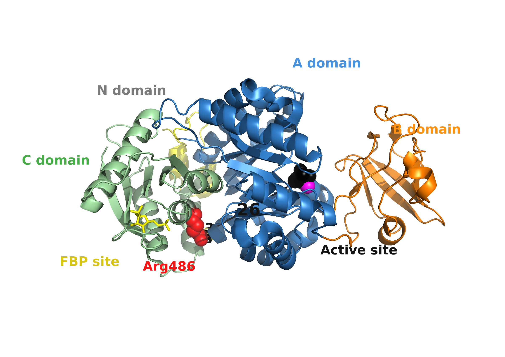
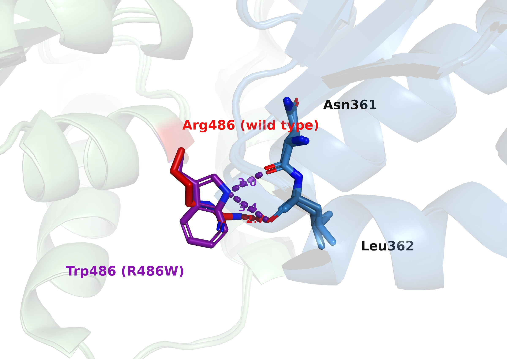
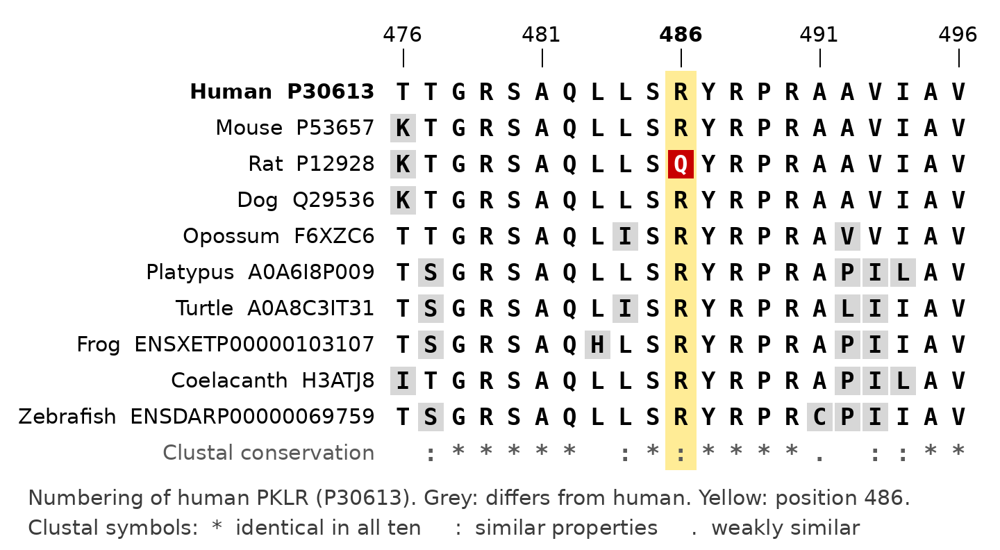

# Pyruvate kinase deficiency: from *PKLR* variant to haemolytic anaemia

Aarón Godino Martínez, Bruno Carrasquilla, Ettore Colombo, Leo Nader Al Hourani, Pol Monllau

Group 11DP-C, BSc in Bioinformatics (UPC-UB-UAB-UPF), Barcelona, Spain

## Abstract

**Background:** Pyruvate kinase deficiency (PKD) is an autosomal recessive disease caused by variants in *PKLR*, the gene of the red-cell pyruvate kinase, the enzyme of the last step of glycolysis. Because red blood cells have no mitochondria and obtain their ATP only from glycolysis, low pyruvate kinase activity shortens their life and causes chronic haemolytic anaemia. Our course provided the wild-type and mutant coding and protein sequences of the enzyme. We aimed to identify the variant, describe its effect on the gene, protein, structure, and function, explain its consequences for the patient, and compare the affected position across vertebrates, including the rat.

**Results:** Pairwise alignment with BLAST showed a single difference between the supplied sequences: c.1456C>T, which changes codon 486 from CGG to TGG and replaces arginine with tryptophan (p.Arg486Trp, R486W). ClinVar classifies the variant as Pathogenic/Likely pathogenic, and gnomAD reports an allele frequency of 0.30%. In the crystal structure of the wild-type enzyme (PDB 2VGB), Arg486 lies at the contact between the C and A domains, about 26 Å from the active site, and forms a hydrogen bond with the backbone of Leu362. The mutant structure (PDB 2VGI) is almost identical to the wild type (RMSD 0.59 Å), and the Trp486 ring forms new hydrogen bonds with the same region. A multiple alignment (Clustal Omega) of PKLR from ten vertebrates showed Arg at position 486 in nine species, from mammals to fish; only the rat has Gln, and no species has Trp. With the dog as outgroup, Arg is most likely the ancestral residue.

**Conclusions:** R486W leaves the shape of pyruvate kinase intact but, according to published enzyme data, reduces its catalytic efficiency to about 30% of normal. In red cells, which depend on glycolysis for ATP, this loss is enough to cause haemolytic anaemia when both copies of *PKLR* are affected. The conservation of Arg486 across vertebrates supports its importance, while the Gln of the rat shows that a similar residue can be tolerated.

## Keywords

pyruvate kinase deficiency; PKLR; haemolytic anaemia; sequence alignment; protein structure

## Background

Pyruvate kinase (PK) catalyses the last step of glycolysis, the irreversible conversion of phosphoenolpyruvate to pyruvate, which produces one molecule of adenosine triphosphate (ATP) (Bianchi and Fermo 2020, Luke *et al.* 2023). The red-cell enzyme is a tetramer of four identical subunits. Each subunit has four domains (N, A, B, and C); the active site lies in the A domain, and fructose 1,6-bisphosphate (FBP), an earlier intermediate of glycolysis, binds to the C domain and activates the enzyme allosterically (Valentini *et al.* 2002).

Mature red blood cells have no nucleus and no mitochondria, so they depend entirely on glycolysis for the ATP they need (Bianchi and Fermo 2020, Fattizzo *et al.* 2022, Luke *et al.* 2023). When PK activity is too low, ATP falls, and the red cells are removed early from the circulation, mainly in the spleen (Bianchi and Fermo 2020, Fattizzo *et al.* 2022). The result is pyruvate kinase deficiency (PKD), a chronic non-spherocytic haemolytic anaemia whose severity ranges from fully compensated haemolysis to life-threatening anaemia in newborns (Bianchi and Fermo 2020). PKD is the most common glycolytic enzyme defect causing this type of anaemia (Bianchi and Fermo 2020); the prevalence of diagnosed PKD in Western populations is estimated at 3.2 to 8.5 cases per million (Secrest *et al.* 2020). Among 254 patients of the PKD Natural History Study, the most frequent complications were iron overload (48%) and gallstones (45%) (Grace *et al.* 2018).

PKD is caused by variants in the gene *PKLR*, which encodes both the red-cell (R-type, 574 amino acids) and the liver (L-type) forms of the enzyme (Bianchi and Fermo 2020, UniProt Consortium 2026). Inheritance is autosomal recessive: patients carry a pathogenic variant on both copies of *PKLR*, either the same variant twice (homozygous) or two different ones (compound heterozygous) (Bianchi and Fermo 2020). In the Natural History Study, 142 of 177 unrelated patients were compound heterozygous (Bianchi *et al.* 2020), and more than 300 different variants have been reported (Bianchi and Fermo 2020). Treatment has long been supportive (transfusions, splenectomy, iron chelation) (Fattizzo *et al.* 2022, Luke *et al.* 2023); mitapivat, an oral activator of PK, is now approved for adults (Luke *et al.* 2023), and in a phase 3 trial 16 of 40 patients treated with mitapivat had a haemoglobin response, compared with none of 40 on placebo (Al-Samkari *et al.* 2022).

Our course provided the coding and protein sequences of a wild-type and a mutant form of the enzyme (IB Teaching Staff 2026). The mutant carries R486W, one of the most frequent mutations in patients with red-cell PK deficiency; its crystal structure and its enzyme activity were described by Valentini *et al.* (2002). Following the question of the Disease Project, how changes in sequence and structure explain the molecular basis of a disease and what comparison tells us about the affected function (IB Teaching Staff 2026), we aimed to: (i) identify the cause of the disease at the level of gene, protein, structure, and function; (ii) describe how the mutant differs from the wild type; (iii) explain the consequences for the patient; and (iv) compare human PKLR with its orthologues in other vertebrates, including the rat, focusing on position 486.

## Results

### The supplied sequences differ by one nucleotide: c.1456C>T, p.Arg486Trp

BLAST identified the supplied sequences: the wild-type coding sequence (CDS, 1725 nucleotides including the stop codon) is identical over its whole length to the CDS of the red-cell *PKLR* transcript NM_000298.6 (NCBI 2026b), and the wild-type protein (574 amino acids) to its product NP_000289.1, the same sequence as UniProt P30613 (UniProt Consortium 2026). The BLAST alignment of wild type and mutant shows 1724 of 1725 identical nucleotides and 573 of 574 identical amino acids, with no gaps. The only difference is at nucleotide 1456, a C in the wild type and a T in the mutant (c.1456C>T). This nucleotide is the first position of codon 486 (3 × 486 − 2 = 1456), which changes from CGG (arginine) to TGG (tryptophan): p.Arg486Trp (R486W). It is a missense substitution: one amino acid is replaced, without a stop codon or a change of reading frame.

The variant is recorded in ClinVar as Pathogenic/Likely pathogenic for pyruvate kinase deficiency, with 30 of 33 submissions contributing to this classification (NCBI 2026a), and UniProt lists it as a natural variant of P30613 found in this disease (UniProt Consortium 2026). In gnomAD v4.1.2 its allele frequency is 0.30% (4766 of 1 613 440 alleles), and eight people are homozygous (gnomAD 2026). The variant is therefore rare (Table 1). Because the disease is autosomal recessive, people who carry it on only one copy of *PKLR* do not have the disease (Bianchi and Fermo 2020).

**Table 1.** The R486W variant. Sources: our BLAST alignments; ClinVar (NCBI 2026a); gnomAD (gnomAD 2026); Valentini *et al.* (2002).

| | |
|---|---|
| Gene | *PKLR* (chromosome 1), red-cell transcript NM_000298.6 |
| DNA change | c.1456C>T (codon 486: CGG → TGG) |
| Protein change | p.Arg486Trp (R486W), missense |
| ClinVar (VCV000001513) | Pathogenic/Likely pathogenic; 30 of 33 submissions |
| gnomAD v4.1.2 | Allele frequency 0.30% (4766 of 1 613 440 alleles); 8 homozygotes |
| Crystal structures | PDB 2VGB (wild type), 2VGI (R486W) |

### Arg486 lies at the contact between the C and A domains, far from the active site

In the crystal structure of the wild-type enzyme (PDB 2VGB; RCSB PDB 2026), Arg486 is in the C domain, where it touches the A domain (Figure 1). Its side chain forms a hydrogen bond (2.7 Å) with the backbone oxygen of Leu362 in the A domain (Figure 2), as described by Valentini *et al.* (2002). Arg486 is about 26 Å from the substrate analogue bound in the active site and about 12 Å from the activator FBP (Figure 1); Valentini *et al.* (2002) also report a distance of more than 20 Å from the catalytic centre.

**Figure 1.** One subunit of human red-cell pyruvate kinase (PDB 2VGB, chain A), coloured by domain (N, yellow; A, blue; B, orange; C, green; limits from Valentini *et al.* 2002). Arg486 (red spheres) lies in the C domain, at the contact with the A domain; the dashed line to the active site (substrate analogue phosphoglycolate in black, Mn²⁺ in magenta) measures 26 Å. The activator FBP is shown as yellow sticks, about 12 Å from Arg486. Made in PyMOL with the commands in `analysis/procedures/7_structure/`.

### The mutant structure is almost identical to the wild type

After superposition of the mutant structure (PDB 2VGI) on the wild type, the root-mean-square deviation (RMSD) of the 517 matched Cα atoms of chain A is 0.59 Å, and the backbone around residue 486 moves by 0.2 to 0.6 Å, as in the rest of the protein. For crystal structures solved at 2.73 Å (2VGB) and 2.87 Å (2VGI) resolution, these differences are very small: the mutation does not change the shape of the protein. Valentini *et al.* (2002) reached the same conclusion: no atomic movement larger than 0.25 Å near the mutation. In the mutant, the ring of Trp486 takes the place of the Arg side chain, and its N–H group forms hydrogen bonds with the backbone oxygens of Asn361 (3.0 Å) and Leu362 (3.4 Å) (Figure 2). Residue 361 is Asn in UniProt P30613 and in both PDB entries; Valentini *et al.* (2002) name it Asp361.

**Figure 2.** Residue 486 at the contact between the C domain (green) and the A domain (blue), with the wild type (2VGB) and the mutant (2VGI) superposed. In the wild type, Arg486 (red) forms a hydrogen bond (2.7 Å, red dashes) with the backbone oxygen of Leu362. In the mutant, the N–H of the Trp486 ring (purple) forms hydrogen bonds with the backbone oxygens of Asn361 (3.0 Å) and Leu362 (3.4 Å) (purple dashes). The surrounding backbone of the two structures overlaps. Made in PyMOL with the commands in `analysis/procedures/7_structure/`.

### Arg486 is conserved from mammals to fish; the rat has Gln

UniProt contains reviewed PKLR entries for only four species, all mammals: human, rat, mouse, and dog (UniProt Consortium 2026). BLAST searches restricted to each of these species found the corresponding full-length PKLR entries in RefSeq (O'Leary *et al.* 2016): the dog protein NP_001243191.1 and the rat protein XP_006232655.1 are identical to the UniProt entries Q29536 and P12928, and the mouse protein NP_038659.2 differs from P53657 at two positions far from residue 486 (279 and 335). In the rat, the only curated RefSeq protein (NP_036756.3) is the liver form, and a second full-length entry, XP_087472322.1, comes from the genome of another rat strain (SHRSP); it differs from P12928 at a single position, residue 486, where it has Arg instead of Gln.

To include more distant vertebrates, we used the one-to-one orthologues of human *PKLR* listed by Ensembl (Dyer *et al.* 2025): opossum, platypus, turtle, frog, coelacanth, and zebrafish. Orthologues are genes in different species that descend from one gene of their common ancestor (Koonin 2005). For these species we relied on Ensembl rather than on BLAST alone, because the best BLAST hits in coelacanth and zebrafish are annotated as PKM, the other pyruvate kinase gene. We did not use the chicken: Ensembl lists no *PKLR* orthologue in chicken, and all chicken BLAST hits are PKM.

The multiple alignment of the ten sequences (Clustal Omega) shows that human PKLR is 91–93% identical to the mouse, rat, and dog sequences and 68–84% identical to the other six (Table 2). At position 486, nine species have Arg; only the rat has Gln, and no species has Trp (Figure 3). The neighbouring residues (SAQLLS-R-YRPR) are also almost identical in all ten species.

We included the dog as an outgroup: its lineage separated from that of primates and rodents about 89 million years ago, before primates and rodents separated from each other, about 84 million years ago (Kumar *et al.* 2022). The dog has Arg at position 486, encoded by the same codon as in human (CGG), and so do the mouse and the six more distant vertebrates. Arg is therefore most likely the ancestral residue, and Gln appeared in the rat lineage after rats and mice separated.

**Table 2.** PKLR in ten vertebrates. Sources: UniProt (UniProt Consortium 2025, 2026), Ensembl (Dyer *et al.* 2025), and our Clustal Omega alignment (identity with human from the percent identity matrix). Rat: reference strain (Brown Norway); the genome of strain SHRSP has Arg at position 486 (see text).

| Species | Entry | Length (aa) | Identity with human | Residue 486 |
|---|---|---|---|---|
| Human | P30613 | 574 | 100% | Arg |
| Mouse | P53657 | 574 | 91.6% | Arg |
| Rat | P12928 | 574 | 91.1% | **Gln** |
| Dog | Q29536 | 574 | 92.5% | Arg |
| Opossum | F6XZC6 | 569 | 84.0% | Arg |
| Platypus | A0A6I8P009 | 568 | 80.9% | Arg |
| Turtle | A0A8C3IT31 | 613 | 72.7% | Arg |
| Frog | ENSXETP00000103107 | 583 | 72.3% | Arg |
| Coelacanth | H3ATJ8 | 530 | 76.4% | Arg |
| Zebrafish | ENSDARP00000069759 | 538 | 67.8% | Arg |

**Figure 3.** Multiple alignment (Clustal Omega) of PKLR from ten vertebrates around position 486 (human numbering, UniProt P30613). Grey: residue different from human; yellow: position 486; red: the rat Gln. Arg486 is present in nine species; the rat has Gln; no species has Trp. Clustal symbols: `*` identical in all sequences, `:` similar, `.` weakly similar.

## Discussion

### From the variant to the patient

Our results connect one nucleotide change to the disease. The substitution c.1456C>T changes codon 486 from CGG to TGG and replaces arginine with tryptophan in the red-cell pyruvate kinase. The structures show that residue 486 sits at the contact between the C and A domains, far from the active site, and that the mutant protein keeps the same shape. The enzyme activity data of Valentini *et al.* (2002) complete the picture: the catalytic efficiency of the R486W enzyme drops to 30% of that of the wild type, while its thermostability is even higher and its response to the activator FBP is essentially unchanged. Red cells have no mitochondria and obtain their ATP only from glycolysis (Bianchi and Fermo 2020, Luke *et al.* 2023); with less pyruvate kinase activity they produce less ATP and are removed early from the circulation, which causes chronic haemolytic anaemia (Bianchi and Fermo 2020, Fattizzo *et al.* 2022). Because the disease is autosomal recessive, it appears when both copies of *PKLR* carry a pathogenic variant (Bianchi and Fermo 2020), for example R486W together with another variant.

### Comparison with Valentini *et al.* (2002)

Our measurements agree with the published analysis of the same structures: Arg486 is hydrogen-bonded to the backbone of Leu362, it is more than 20 Å from the catalytic centre, and the mutant structure shows almost no change (Valentini *et al.* 2002). This raises a question: how can a substitution that does not change the structure reduce the activity of a distant active site? Valentini *et al.* (2002) propose that the large Trp ring may restrict the movements that the enzyme makes during catalysis; this is a hypothesis that the crystal structures alone cannot test. They also note that, in the cell, the enzyme works below saturation with its substrates, which may amplify the effect of a moderate loss of efficiency. This fits the clinical picture: patients homozygous for R486W generally have mild anaemia (Valentini *et al.* 2002).

### What the species comparison shows about the affected function

Arg486 is present in nine of the ten vertebrates we compared, from mammals to fish, and the residues around it are also nearly identical. Residues conserved over long evolutionary distances are often important for structure or function (Capra and Singh 2007), which agrees with the role of Arg486 in the contact between two domains. With the dog as outgroup, Arg is most likely the ancestral residue, and Gln is a later change of the rat lineage. That a healthy species carries Gln shows that the position can tolerate a change; two rat genomes annotated in RefSeq even differ at this position, which suggests variation within the rat, although sequencing more rats would be needed to confirm it. Clustal Omega marks this column with ':', which means that Arg and Gln have strongly similar properties; Trp, in contrast, is hydrophobic and aromatic, whereas Arg is positively charged (Škrbić *et al.* 2024), and no species in our comparison has Trp. We did not measure the activity of the rat enzyme, and Valentini *et al.* (2002) warn that the effect of a mutation in human red-cell PK cannot simply be predicted from other forms of the enzyme; the rat Gln is therefore a clue, not a proof.

### The dog: the same enzyme and the same disease

PK deficiency also occurs naturally in dogs, where it is the most common inherited enzyme defect of red cells; each affected breed carries a different *PKLR* mutation, and affected dogs have chronic haemolytic anaemia and iron overload, as human patients do (Gultekin *et al.* 2012). Dog R-type PK has 574 amino acids, like the human enzyme, so positions can be compared directly. The Beagle mutation c.994G>A, p.Gly332Ser (Gultekin *et al.* 2012), is the same nucleotide and amino-acid change as the human mutation G332S, which in homozygous patients causes severe anaemia that requires regular transfusions (Valentini *et al.* 2002). No dog mutation at position 486 has been reported in the studies we consulted. The dog thus shares with humans the residue at position 486, at least one disease mutation, and the clinical picture of the disease.

### Limitations

Our comparison includes ten species; except for the four mammals with reviewed UniProt entries, the sequences are automatic annotations, which we accepted only when Ensembl lists them as one-to-one orthologues. For the rat we used the reference strain; the residue at position 486 differs between two rat genomes annotated in RefSeq. The ancestral residue is an inference from the outgroup, not a measurement. Our structural analysis relies on one wild-type and one mutant crystal structure, at 2.7 and 2.9 Å resolution; crystal structures are static and cannot show changes in flexibility. We did not perform any laboratory measurement: all enzyme activity data come from Valentini *et al.* (2002). Finally, database records change over time, and ClinVar and gnomAD values are those of the records we consulted.

## Conclusions

The supplied mutant sequence differs from the wild type by one nucleotide, c.1456C>T, which replaces arginine 486 with tryptophan (p.Arg486Trp) in red-cell pyruvate kinase. The variant is classified as Pathogenic/Likely pathogenic in ClinVar and is rare in the population (0.30%). Arg486 lies at the contact between the C and A domains, about 26 Å from the active site, and the mutant crystal structure is almost identical to the wild type. The published enzyme data show that the mutant keeps its stability and its activation by FBP but works with about 30% of the normal catalytic efficiency (Valentini *et al.* 2002). Because red cells depend on glycolysis for ATP, this loss of activity is enough to shorten their life and cause chronic haemolytic anaemia when both copies of *PKLR* are affected. Arg486 is conserved in nine of ten vertebrates, from mammals to fish, and is most likely the ancestral residue; the rat has the similar residue Gln, and no species has Trp. Dogs, which share Arg486 with humans, also develop PK deficiency, in Beagles through the same G332S change found in human patients. Our work shows how sequence alignment, database records, and structure comparison together explain a disease caused by a change that leaves the protein's shape intact but reduces its function.

## Methods

### Data sources

The wild-type and mutant coding and protein sequences were provided by the course (IB Teaching Staff 2026). We identified them with BLAST at NCBI (Altschul *et al.* 1990), using blastn for the coding sequences and blastp for the proteins against the default databases, and chose the best curated RefSeq hits (O'Leary *et al.* 2016): the *PKLR* transcript NM_000298.6 (NCBI 2026b) and its protein NP_000289.1, which is identical to UniProt P30613 (UniProt Consortium 2026). Variant information came from ClinVar (record VCV000001513; NCBI 2026a), gnomAD v4.1.2 (gnomAD 2026), and UniProt. The reviewed PKLR entries of rat (P12928), mouse (P53657), and dog (Q29536) came from UniProt (UniProt Consortium 2026); we checked them against BLAST searches restricted to each species (databases RefSeq protein and RefSeq RNA), in which we chose the PKLR entry covering the whole human query, that is, the red-cell form. For other vertebrates, we used the one-to-one orthologues of human *PKLR* (ENSG00000143627) listed by Ensembl (Dyer *et al.* 2025) and the corresponding UniProt entries where available (UniProt Consortium 2025). Divergence times between species were taken from TimeTree (Kumar *et al.* 2022). The crystal structures of the wild-type enzyme (PDB 2VGB) and of the R486W mutant (PDB 2VGI) (Valentini *et al.* 2002) were downloaded from the RCSB Protein Data Bank (RCSB PDB 2026). Copies of the database records are stored in the `references/` folder of our repository, and every analysis step (input files, screenshots, and output files) in the `analysis/procedures/` folder.

### Sequence analysis

Pairwise alignments were made with BLAST on the NCBI website, with the option "Align two or more sequences" (blastn for coding sequences, blastp for proteins) and the default settings; the variant was located in the "Query-anchored with dots for identities" view. The multiple alignment of the ten PKLR sequences was made with Clustal Omega (Sievers *et al.* 2011) on the EMBL-EBI website (Madeira *et al.* 2024), with the default settings; percent identities were taken from its percent identity matrix, and position 486 was read in the column aligned with human Arg486.

### Structure analysis

Structures were analysed with PyMOL (Schrödinger, LLC). For each structure we used chain A. Domains were coloured with the residue limits given by Valentini *et al.* (2002): N, 57–84; A, 85–159 and 263–431; B, 160–262; C, 432–574. The mutant was superposed on the wild type with the PyMOL command `align` on the Cα atoms of chain A, without outlier rejection (`cycles=0`), which gives the RMSD. Distances and hydrogen bonds were measured with the PyMOL commands `distance` and `get_distance`. Figures 1 and 2 were made with the same list of PyMOL commands, which is stored with the analysis.

### Statistical analysis

No statistical analysis was performed.

## Abbreviations

aa: amino acids; ATP: adenosine triphosphate; BLAST: Basic Local Alignment Search Tool; CDS: coding sequence; FBP: fructose 1,6-bisphosphate; gnomAD: Genome Aggregation Database; PDB: Protein Data Bank; PK: pyruvate kinase; PKD: pyruvate kinase deficiency; RMSD: root-mean-square deviation.

## Declarations

### Availability of data and materials

All data, alignments, figures, and sources used in this work are available in our GitHub repository, including every analysis step with its input files, screenshots, and outputs (folder `analysis/procedures/`): https://github.com/XxNaderTheKing08Xx/11DP-C_Pyruvate-Kinase-Deficiency_IB_2026

### Authors' contributions

AGM wrote the Background, the Abstract, the Abbreviations, and the Declarations, and deposited the cited articles. BC characterized the supplied sequences, performed the species comparison, wrote the Results on the variant and on the species comparison, and prepared Table 2 and Figure 3. EC managed the project, wrote the Discussion and the Conclusions, assembled the report, and prepared the final Project Status and Gantt chart. LNAH collected the database records, prepared Table 1, and wrote the Methods and the References. PM performed the structure analysis, wrote the Results on the structures, prepared Figures 1 and 2, and revised the Lab 1 notebook. All authors read and approved the final manuscript.

### Use of generative AI

Generative AI was used, in line with the course guidelines, for drafting and reviewing text, for formatting, and for understanding concepts; the authors checked all content and take responsibility for it.

## References

Al-Samkari H et al. Mitapivat versus placebo for pyruvate kinase deficiency. N Engl J Med 2022;386:1432–42.

Altschul SF et al. Basic local alignment search tool. J Mol Biol 1990;215:403–10.

Bianchi P, Fermo E. Molecular heterogeneity of pyruvate kinase deficiency. Haematologica 2020;105:2218–28.

Bianchi P et al. Genotype-phenotype correlation and molecular heterogeneity in pyruvate kinase deficiency. Am J Hematol 2020;95:472–82.

Capra JA, Singh M. Predicting functionally important residues from sequence conservation. Bioinformatics 2007;23:1875–82.

Dyer SC et al. Ensembl 2025. Nucleic Acids Res 2025;53:D948–57.

Fattizzo B et al. Pyruvate kinase deficiency: current challenges and future prospects. J Blood Med 2022;13:461–71.

gnomAD. Variant 1-155291918-G-A, gnomAD v4.1.2. https://gnomad.broadinstitute.org/variant/1-155291918-G-A?dataset=gnomad_r4 (22 October 2026, date last accessed).

Grace RF et al. Clinical spectrum of pyruvate kinase deficiency: data from the Pyruvate Kinase Deficiency Natural History Study. Blood 2018;131:2183–92.

Gultekin GI et al. Erythrocytic pyruvate kinase mutations causing hemolytic anemia, osteosclerosis, and secondary hemochromatosis in dogs. J Vet Intern Med 2012;26:935–44.

IB Teaching Staff. Disease Project Overview [course document]. Introduction to Bioinformatics, 2026–2027. Barcelona: Universitat Politècnica de Catalunya, 2026.

Koonin EV. Orthologs, paralogs, and evolutionary genomics. Annu Rev Genet 2005;39:309–38.

Kumar S et al. TimeTree 5: an expanded resource for species divergence times. Mol Biol Evol 2022;39:msac174.

Luke N et al. Updates and advances in pyruvate kinase deficiency. Trends Mol Med 2023;29:406–18.

Madeira F et al. The EMBL-EBI Job Dispatcher sequence analysis tools framework in 2024. Nucleic Acids Res 2024;52:W521–5.

NCBI. ClinVar VCV000001513: NM_000298.6(PKLR):c.1456C>T (p.Arg486Trp). https://www.ncbi.nlm.nih.gov/clinvar/variation/1513/ (22 October 2026, date last accessed). [cited as NCBI 2026a]

NCBI. Homo sapiens pyruvate kinase L/R (PKLR), transcript variant 1, mRNA. NM_000298.6. https://www.ncbi.nlm.nih.gov/nuccore/NM_000298.6 (22 October 2026, date last accessed). [cited as NCBI 2026b]

O'Leary NA et al. Reference sequence (RefSeq) database at NCBI: current status, taxonomic expansion, and functional annotation. Nucleic Acids Res 2016;44:D733–45.

RCSB PDB. 2VGB: Human erythrocyte pyruvate kinase; 2VGI: Human erythrocyte pyruvate kinase: R486W mutant. https://www.rcsb.org/structure/2VGB and https://www.rcsb.org/structure/2VGI (22 October 2026, date last accessed).

Schrödinger, LLC. The PyMOL Molecular Graphics System. https://www.pymol.org/ (22 October 2026, date last accessed).

Secrest MH et al. Prevalence of pyruvate kinase deficiency: a systematic literature review. Eur J Haematol 2020;105:173–84.

Sievers F et al. Fast, scalable generation of high-quality protein multiple sequence alignments using Clustal Omega. Mol Syst Biol 2011;7:539.

Škrbić T et al. Amino-acid characteristics in protein native state structures. Biomolecules 2024;14:805.

UniProt Consortium. UniProt: the Universal Protein Knowledgebase in 2025. Nucleic Acids Res 2025;53:D609–17.

UniProt Consortium. UniProtKB entries P30613 (KPYR_HUMAN), P12928 (KPYR_RAT), P53657 (KPYR_MOUSE), and Q29536 (KPYR_CANLF). https://www.uniprot.org/ (22 October 2026, date last accessed).

Valentini G et al. Structure and function of human erythrocyte pyruvate kinase. Molecular basis of nonspherocytic hemolytic anemia. J Biol Chem 2002;277:23807–14.
